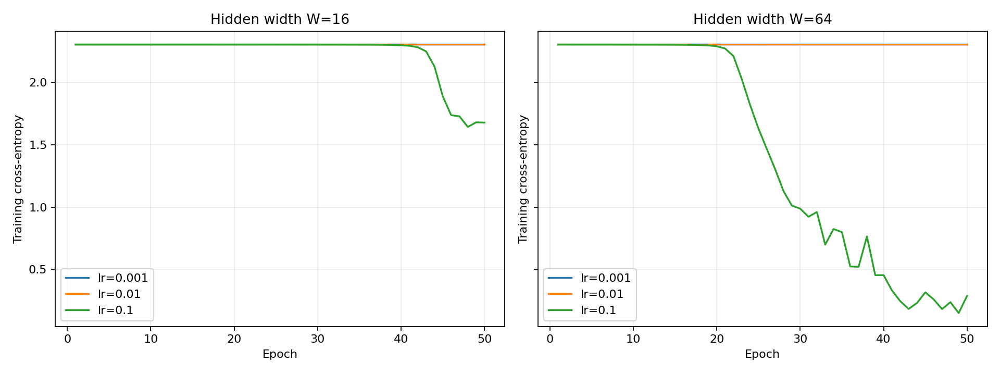

# Lab 2: Neural network from scratch

## Data and architecture

`load_digits` contains 1,797 images of size 8×8 and 10 classes. Pixel values are
divided by 16 and labels are one-hot encoded. A stratified 70/30 split with
random_state=42 gives 1,257 training and 540 test examples.

Architecture: **64 → W → ReLU → W → ReLU → 10 → softmax**, with W=16 or 64.
Weights are sampled from a normal distribution with mean 0 and standard deviation
0.01; biases start at zero. Training uses NumPy float64 and manual gradients.

| Parameter | W=16 | W=64 |
|---|---|---|
| W1 | (64,16) | (64,64) |
| b1 | (16,) | (64,) |
| W2 | (16,16) | (64,64) |
| b2 | (16,) | (64,) |
| W3 | (16,10) | (64,10) |
| b3 | (10,) | (10,) |
| Total parameters | 1482 | 8970 |

## Forward pass and gradients

For a batch of B examples:

```text
Z1 = X W1 + b1; A1 = max(0,Z1)
Z2 = A1 W2 + b2; A2 = max(0,Z2)
Z3 = A2 W3 + b3; P = softmax(Z3)
L = −(1/B) Σ_i Σ_k Y_ik log(P_ik)
```

Softmax subtracts each row's maximum, and the loss uses stable log-softmax.
The output shape (B,10) and row sums of 1 were checked with tolerance 1e−6.
Initial losses of 2.30258552 and 2.30258549 are close to ln(10)=2.30258509.

The combined softmax and cross-entropy derivative is (P−Y)/B. The ReLU derivative
is 1 for positive inputs and 0 otherwise, including zero in this implementation.
Applying the chain rule gives:

```text
D3 = (P − Y)/B                     [B,10]
∂L/∂W3 = A2ᵀ D3                   [W,10]
∂L/∂b3 = sum_rows(D3)              [10]
D2 = (D3 W3ᵀ) ⊙ (Z2 > 0)         [B,W]
∂L/∂W2 = A1ᵀ D2                   [W,W]
∂L/∂b2 = sum_rows(D2)              [W]
D1 = (D2 W2ᵀ) ⊙ (Z1 > 0)         [B,W]
∂L/∂W1 = Xᵀ D1                    [64,W]
∂L/∂b1 = sum_rows(D1)              [W]
θ ← θ − η ∂L/∂θ
```

Here, ⊙ denotes element-wise multiplication. Gradients are averaged over B once.
Predictions use argmax(P).

## Gradient check

Ten distinct random weight coordinates were checked for each width using a batch
of 32 and the central difference:

```text
g_num = [L(θ+ε) − L(θ−ε)] / (2ε), ε=1e−5
relative error = |g−g_num| / max(1e−12, |g|+|g_num|)
```

Both widths passed **10/10** checks at a relative-error threshold of 1e−6;
the requirement is at least 9/10. Results are in `results/gradient_check.csv`.

Subtracting two losses near 2.3 loses precision when the initial gradients are
small. The implementation therefore computes the same loss difference using
log1p and expm1. For δ=Z3_plus−Z3_minus, the log-sum-exp difference is
`log1p(Σ_k P_minus,k expm1(δ_k))`. It subtracts `Σ_k Y_k δ_k` and averages the
result. This numerical check uses forward passes only.

## Training results

Each configuration trains for 50 epochs with shuffled batches of 32; the last
batch contains 9 examples. Weights are reset with seed=42 before each run, and
the shuffle seed is 2026. The plotted loss is measured on the full training set
after each epoch. Test data are excluded from weight updates.

| W | η | Train loss | Test accuracy | Forward, ms | Backward, ms |
|---|---|---|---|---|---|
| 16 | 0.001 | 2.302554 | 10.19% | 0.13255 | 0.13575 |
| 16 | 0.01 | 2.302482 | 10.19% | 0.09165 | 0.09275 |
| 16 | 0.1 | 1.677100 | 32.41% | 0.08900 | 0.09055 |
| 64 | 0.001 | 2.302530 | 10.19% | 0.12610 | 0.15400 |
| 64 | 0.01 | 2.302348 | 10.19% | 0.14160 | 0.17325 |
| 64 | 0.1 | 0.288016 | 89.44% | 0.19045 | 0.21985 |



## Timing and conclusions

Timings are medians of 100 runs after 10 warmups, using a batch of 32 and one
BLAS thread. Backward uses a prepared cache and excludes the forward pass and
weight update. Forward performs three matrix products; backward performs five:
three for weight gradients and two for error propagation.

Backward was slower for every configuration, although the W=16 times were close.
For these small matrices, NumPy overhead, softmax and timer noise also contribute.
The middle layer scales as B·W²; the other layers scale as B·64·W and B·W·10.

The best result was **89.44%** with W=64 and η=0.1. The smaller learning rates
barely reduced loss in 50 epochs. Small initial weights produce a weak gradient
through the two hidden layers in this configuration.

## Reproduction

From the repository root, using the activated environment:

```powershell
python lab02/src/run_lab.py
```

Dependencies are NumPy, Matplotlib, scikit-learn and threadpoolctl.
Results are saved as `results/loss_curves.png`, `metrics.csv`,
`training_history.csv`, `gradient_check.csv` and `configuration.json`.
The original run log is `results/run.log`.
