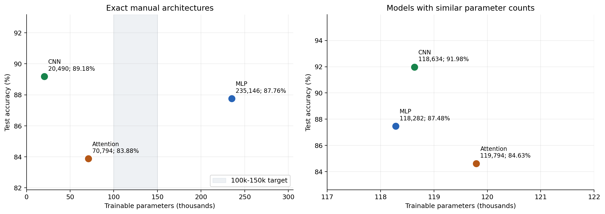
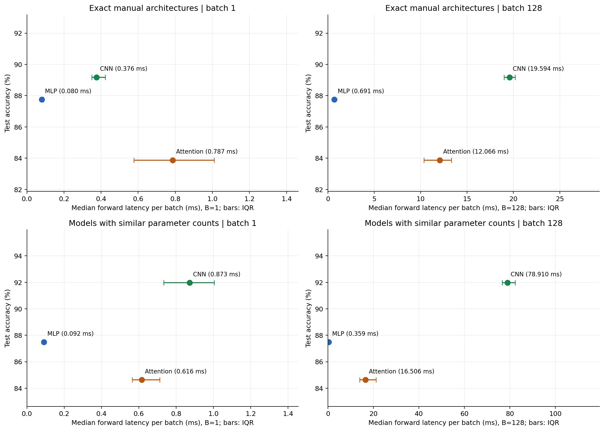
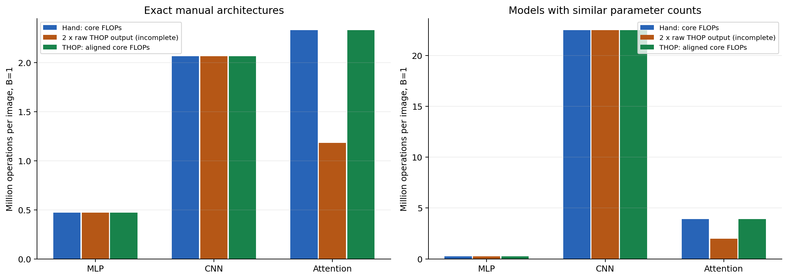
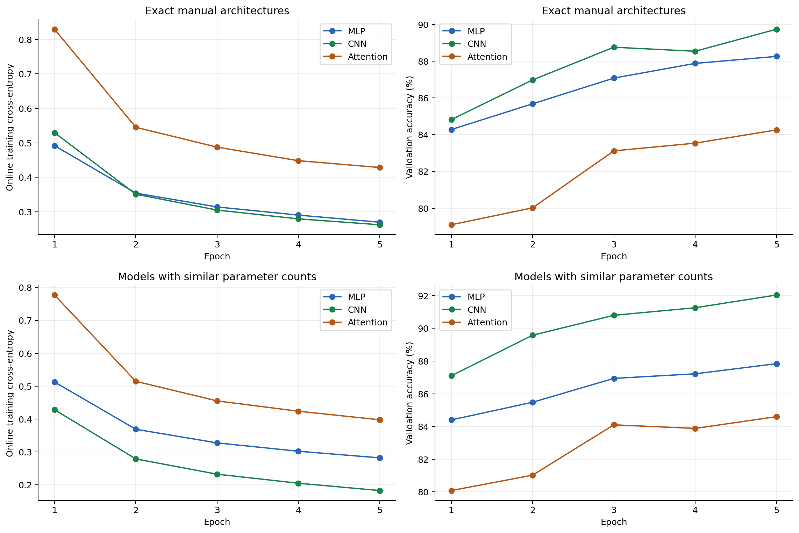

# Lab 3: Architectures and their costs

## Мета та відтворення

Порівняти MLP, CNN та attention за точністю Fashion-MNIST, кількістю параметрів,
арифметичною вартістю, затримкою inference та характером доступу до пам'яті.
Усі числа нижче отримані виконанням коду; точність не є оцінкою чи прикладом.

З кореня репозиторію:

```powershell
python main.py
```

За замовчуванням виконуються **обидва** експерименти: точні схеми з інструкції
(`reference`) та окремі моделі однакового порядку розміру (`matched`).
Кожна з шести моделей навчається рівно 5 епох. Окремі варіанти запуску:

```powershell
python main.py --suite reference
python main.py --suite matched
python main.py --report-only
.\.venv\Scripts\python.exe lab03/src/check_lab.py
```

Launcher використовує поточний Python або готову локальну `.venv`, якщо у поточному
немає PyTorch. Дані завантажуються через `torchvision.datasets.FashionMNIST` у
`data/`, що виключено з Git. За недоступності історичного HTTP-сервера код
використовує HTTPS-дзеркало авторів з перевіркою оригінальних MD5.

## Дані й протокол

- Офіційні 60 000 навчальних зображень розділено на **55 000 train / 5 000 validation**.
  Офіційні **10 000 test** залишені окремо. Індекси збережені в `results/split_indices.npz`.
- Перетворення точно за умовою: `ToTensor()` і `Normalize((0.2860,), (0.3530,))`.
  Зображення мають форму `[B,1,28,28]`; мітки — цілі числа 0–9.
- Batch size **128**, `drop_last=False`, без augmentation. Для всіх моделей однакові
  індекси train/validation і послідовності перемішування пакетів.
- **Adam, lr=0.001, 5 епох**, стандартні betas `(0.9,0.999)`, eps `1e-8`,
  weight decay 0; `CrossEntropyLoss` отримує logits без попереднього softmax.
- Seed **42** для Python, NumPy, PyTorch, поділу й перемішування.
  Детерміновані алгоритми увімкнено. Validation обчислюється після кожної епохи;
  test accuracy фіксується для фінальної 5-ї епохи, без вибору за test.
- Середовище: **AMD Ryzen 5 5500U with Radeon Graphics**, `cpu`, FP32,
  intra-op threads **2**, inter-op threads **1**.
  Python 3.11.8, PyTorch 2.3.1,
  torchvision 0.18.1, torchinfo 1.8.0,
  THOP 0.1.1-2209072238, NumPy 1.26.4,
  Matplotlib 3.9.0. Повна конфігурація — `results/configuration.json`.

## Архітектури та суперечність в інструкції

Точні розміри шарів з п. 2 **несумісні** з одночасною вимогою 100–150 тисяч
параметрів. Це перевірено ручним підрахунком, `torchinfo.summary` та
`sum(p.numel() for p in model.parameters())`. Щоб покрити обидві вимоги,
точні архітектури збережено окремо від експерименту з близькою кількістю параметрів.

| Експеримент | MLP | CNN | Attention | Кількість параметрів |
|---|---|---|---|---|
| reference | 784→256→128→10, ReLU | Conv 1→16→32, 3×3, padding 1, pool 2 після кожної; Linear 1568→10 | 16 патчів 7×7, d=64, heads=4, FF=128, 2 encoders | 235 146 / 20 490 / 70 794 |
| matched | 784→128→128→10, ReLU | Conv 1→48→128; ті самі kernel, padding та pooling; Linear 6272→10 | d=84, heads=4, FF=168, 2 encoders; ті самі 16 патчів | 118 282 / 118 634 / 119 794 |

У `matched` змінено тільки ширини; глибина та родини операцій збережені.
Максимальна різниця кількості параметрів між моделями — близько 1.28% від мінімальної.
Це дає контрольованіше порівняння, але однакова кількість параметрів не означає
однакові FLOPs чи однакову точність.

Attention: `[B,1,28,28] → [B,16,49] → Linear(49,d) → 2 TransformerEncoderLayer
→ mean(dim=1) → Linear(d,10)`. Encoder має ReLU, dropout 0.1, залишкові зв'язки
та два LayerNorm, `batch_first=True`, post-norm; кожний encoder ініціалізується
окремо. Mean pooling не змішує різні зображення пакета.
У схемі з інструкції немає positional embedding або class token, тому вони
не додані: після mean pooling модель інваріантна до перестановки 16 патчів.
Позиції пікселів усередині кожного патча збережені, взаємне розташування патчів — ні.
Це обмеження враховано при поясненні точності.

## Ручний підрахунок параметрів

Bias включено всюди. Для Linear: `in*out + out`; для Conv:
`K*K*Cin*Cout + Cout`; LayerNorm(d) має `2*d` trainable коефіцієнтів.

- MLP: `(784*256+256) + (256*128+128) + (128*10+10)`
  `= 200960 + 32896 + 1290 = 235146`.
- CNN: `(3*3*1*16+16) + (3*3*16*32+32) + (1568*10+10)`
  `= 160 + 4640 + 15690 = 20490`.
- Attention projection: `49*64+64 = 3200`; один encoder:
  QKV `3*64*64+3*64 = 12480`, output `64*64+64 = 4160`,
  FF1 `64*128+128 = 8320`, FF2 `128*64+64 = 8256`,
  два LayerNorm `4*64 = 256`. Разом `33472` на encoder;
  уся модель `3200 + 2*33472 + (64*10+10) = 70794`.

Усі покомпонентні підрахунки, включно з `matched`, збережені в
`results/<suite>/hand_calculations.csv`; форми тензорів і таблиці параметрів —
`results/<suite>/*_summary.txt` з `torchinfo.summary`.

## Ручні FLOPs та порівняння з THOP

Узгоджена конвенція: **одне множення + одне додавання = 2 FLOPs**,
batch=1. `Core FLOPs` тут рахують матричні добутки та згортки.
Bias, ReLU, порівняння MaxPool, softmax, LayerNorm, residual additions та
mean pooling не включені. Це представницька арифметична вартість,
а не виміряні інструкції процесора або повна вартість усіх операцій.
Формули згортки рахують також операції на нульовому padding.

Репрезентативні шари точних архітектур:

```text
MLP Linear(784,256):
  2 * 784 * 256 = 401408 FLOPs.
  Вся MLP: 401408 + 65536 + 2560 = 469504.

CNN Conv2d(1,16,3,padding=1), вихід 16x28x28:
  2 * 3 * 3 * 1 * 16 * 28 * 28 = 225792 FLOPs.
  Conv2 (32x14x14): 2 * 3 * 3 * 16 * 32 * 14 * 14 = 1806336.
  Linear: 2 * 1568 * 10 = 31360. Разом: 2063488.

Attention, один encoder: L=16, d=64, h=4, head_dim=16, FF=128:
  QKV:             2 * 16 * 64 * (3 * 64) = 393216
  QK^T:            2 * h * L^2 * (d/h)   = 32768
  Attention @ V:   2 * h * L^2 * (d/h)   = 32768
  Output proj:     2 * 16 * 64 * 64      = 131072
  FF1 + FF2:       2 * (2 * 16 * 64 * 128) = 524288
  Один encoder: 1114112 FLOPs.
  Projection 16 * Linear(49,64): 100352; classifier: 1280.
  Вся Attention: 100352 + 2 * 1114112 + 1280 = 2329856.
```

Кількість голів не додає ще одного множника `h` поверх `d`: сума розмірностей
голів дорівнює `d`. Для двох attention encoder повна формула core FLOPs:
`2*L*49*d + 2*(8*L*d^2 + 4*L^2*d + 4*L*d*FF) + 2*d*10`.

`thop.profile` повертає MACs для Linear/Conv, тому їх множимо на два.
У зафіксованій версії немає повного правила для `nn.MultiheadAttention`;
крім того, LayerNorm рахується в інших одиницях. Вивід «2 × raw THOP» для
attention є лише діагностикою і не може вважатися повними FLOPs.
Збережено початковий результат і окреме профілювання з власним hook для MHA,
який за фактичними розмірами входу рахує QKV, scores, weighted values і output
projection. LayerNorm виключено для узгодження з ручними core FLOPs.

Під час профілювання вимикається fused MHA/encoder fastpath: у PyTorch 2.3
він обходить module hooks. Потім попередній стан відновлюється; звичайний
inference benchmark використовує оптимізації PyTorch. THOP запускається на
копіях моделей, тому його службові buffers не потрапляють у checkpoint.


### reference: виміряні результати

| Модель | Параметри | Core FLOPs | Ваги FP32, KiB | Test accuracy | B=1, ms | B=128, ms/пакет | B=128, ms/зображення |
|---|---:|---:|---:|---:|---:|---:|---:|
| MLP | 235,146 | 469,504 | 918.54 | 87.76% | 0.08030 | 0.69075 | 0.00540 |
| CNN | 20,490 | 2,063,488 | 80.04 | 89.18% | 0.37565 | 19.59360 | 0.15308 |
| Attention | 70,794 | 2,329,856 | 276.54 | 83.88% | 0.78665 | 12.06595 | 0.09427 |


| Модель | Ручні core FLOPs | THOP raw ops | 2×raw (діагностика) | THOP core FLOPs | Різниця core | THOP raw params / torchinfo |
|---|---:|---:|---:|---:|---:|---:|
| MLP | 469,504 | 234,752 | 469,504 | 469,504 | 0.00% | 235,146 / 235,146 |
| CNN | 2,063,488 | 1,031,744 | 2,063,488 | 2,063,488 | 0.00% | 20,490 / 20,490 |
| Attention | 2,329,856 | 591,488 | 1,182,976 | 2,329,856 | 0.00% | 37,514 / 70,794 |


Незалежне профілювання окремого шару з фінального checkpoint:

| Шар | Ручні FLOPs | THOP MACs | THOP FLOPs |
|---|---:|---:|---:|
| Linear 784 to 256 | 401,408 | 200,704 | 401,408 |
| Conv2d 1 to 16 | 225,792 | 112,896 | 225,792 |
| MultiheadAttention L=16 d=64 h=4 | 589,824 | 294,912 | 589,824 |


Для reference Attention точний розклад розбіжності: raw THOP 591,488 = core MACs 1,164,928 − невраховані MHA MACs 589,824 + LayerNorm ops 16,384. Raw parameter count також пропускає ваги MHA. Власне правило відновлює повний підрахунок параметрів і core MACs.


### matched: виміряні результати

| Модель | Параметри | Core FLOPs | Ваги FP32, KiB | Test accuracy | B=1, ms | B=128, ms/пакет | B=128, ms/зображення |
|---|---:|---:|---:|---:|---:|---:|---:|
| MLP | 118,282 | 236,032 | 462.04 | 87.48% | 0.09180 | 0.35890 | 0.00280 |
| CNN | 118,634 | 22,478,848 | 463.41 | 91.98% | 0.87260 | 78.91010 | 0.61649 |
| Attention | 119,794 | 3,918,096 | 467.95 | 84.63% | 0.61585 | 16.50580 | 0.12895 |


| Модель | Ручні core FLOPs | THOP raw ops | 2×raw (діагностика) | THOP core FLOPs | Різниця core | THOP raw params / torchinfo |
|---|---:|---:|---:|---:|---:|---:|
| MLP | 236,032 | 118,016 | 236,032 | 236,032 | 0.00% | 118,282 / 118,282 |
| CNN | 22,478,848 | 11,239,424 | 22,478,848 | 22,478,848 | 0.00% | 118,634 / 118,634 |
| Attention | 3,918,096 | 991,368 | 1,982,736 | 3,918,096 | 0.00% | 62,674 / 119,794 |


Незалежне профілювання окремого шару з фінального checkpoint:

| Шар | Ручні FLOPs | THOP MACs | THOP FLOPs |
|---|---:|---:|---:|
| Linear 784 to 128 | 200,704 | 100,352 | 200,704 |
| Conv2d 1 to 48 | 677,376 | 338,688 | 677,376 |
| MultiheadAttention L=16 d=84 h=4 | 989,184 | 494,592 | 989,184 |


Для matched Attention точний розклад розбіжності: raw THOP 991,368 = core MACs 1,959,048 − невраховані MHA MACs 989,184 + LayerNorm ops 21,504. Raw parameter count також пропускає ваги MHA. Власне правило відновлює повний підрахунок параметрів і core MACs.


## Протокол inference latency

Для кожної вже навченої моделі: `eval()` і `torch.inference_mode()`, 20 warmup
проходів окремо для кожного batch size. Далі **медіана 100 запусків для B=1**
та **медіана 20 запусків для B=128**. Таймер — `perf_counter_ns()`.
Вхід — однакові перші 128 test-зображень; потрібний пакет уже підготовлений
і перенесений на пристрій до таймера. Таймер охоплює повний forward моделі,
включно з patchify та mean pooling; завантаження даних, transforms і transfer
виключені. Для CUDA виконується synchronization перед та після кожного запуску.
Вимірювання проводяться послідовно при однакових налаштуваннях потоків.

Кожен запуск є окремим рядком у `results/<suite>/latency_runs.csv`.
`metrics.csv` містить median, 25-й і 75-й перцентилі, ms/зображення та throughput.
На графіках горизонтальні відрізки означають IQR latency; це не довірчий
інтервал accuracy. B=128 показано як час **усього пакета**, а ms/зображення
обчислюється діленням на 128.

## Графіки









Також збережено SVG кожного графіка для масштабування без втрати якості.

## Архітектурні компроміси та доступ до пам'яті (§4.6–4.7)

**MLP.** Dense Linear виконує регулярні matrix-vector/matrix-matrix добутки.
При B=1 арифметична інтенсивність мала: кожна вага використовується для одного
зображення. При B=128 ті самі ваги використовуються для багатьох прикладів,
що поліпшує reuse і завантаження обчислювальних блоків. Для першого reference
Linear, ігноруючи cache та інший трафік, нижня оцінка читання ваг —
`784*256*4 = 802816` байтів на 401408 FLOPs при B=1, тобто близько
0.5 FLOP/byte; при повному reuse на B=128 — близько 64 FLOP/byte щодо самих ваг.
Це модель арифметичної інтенсивності, а не апаратне вимірювання DRAM-трафіку.
MLP ігнорує просторову структуру зображення і витрачає багато параметрів на
перший шар, зате має коротку послідовність операцій.

**CNN.** Sliding windows використовують просторову локальність; один фільтр
повторно застосовується в кожній позиції. Мала кількість ваг може відповідати
великій кількості FLOPs. Для reference CNN 20 490 параметрів забезпечують
2 063 488 core FLOPs, бо ваги Conv багаторазово повторно використовуються.
Pooling зменшує просторовий розмір наступних активацій. Трафік включає карти
ознак: перший reference Conv створює `16*28*28=12544` float32 елементів,
тобто 49 KiB на зображення, а не лише 80.04 KiB ваг усієї мережі.
У matched CNN більші channel dimensions збільшують FLOPs і проміжні тензори
значно сильніше, ніж у MLP того самого розміру. Реальні бібліотеки можуть
використовувати tiling чи тимчасові buffers; обсяг останніх тут не вимірювався.

**Attention.** QKV і FFN — регулярні dense GEMM, attention додає глобальні
залежності між патчами, softmax та редукції. Для L=16, h=4 логічна матриця
scores має `h*L*L=1024` елементи, 4 KiB на зображення на encoder
(512 KiB для B=128), а QKV — `3*L*d` елементів. Із ростом L score-вартість
зростає квадратично. Для короткої послідовності цього експерименту проєкції
та FFN переважають у core FLOPs. Перестановки, читання/запис активацій,
LayerNorm, residual connections і виклики багатьох операторів створюють
затримку, яку параметри чи core FLOPs самі по собі не описують.
Scores — логічний обсяг, а не виміряний peak RAM: fused kernels можуть уникати
повної матеріалізації деяких тензорів. Щільний attention реалізовано регулярними
матричними операціями; content-dependent weights не означають випадкові
апаратні gathers. Без positional embedding модель втрачає порядок патчів,
що разом із коротким навчанням є можливим поясненням її точності.

У термінах підручника: MLP використовує регулярні доступи й reuse ваг у пакеті;
CNN додає sliding-window locality і weight sharing; attention комбінує dense
проєкції, broadcast/reduction та глобальне змішування інформації. У всіх трьох
архітектурах data movement, cache locality, operator fusion і паралелізм
впливають на latency. За самою кількістю FLOPs не можна встановити, чи ця
конкретна мережа memory-bound або compute-bound: для цього потрібні hardware
counters або roofline-профілювання. Патерни вище є аналізом структури алгоритмів.


## Висновки за фактичними вимірюваннями


**reference.** Найвища test accuracy у CNN (89.18%). Найменша B=1 latency у MLP (0.08030 ms); найменше параметрів у CNN (20,490). CNN проти MLP: різниця точності +1.42 відсоткових пунктів, відношення core FLOPs 4.40×, відношення B=1 latency 4.68×.

За трьома критеріями (більша accuracy, менші parameters і B=1 latency) на Pareto-межі reference: **MLP, CNN**. Вибір залежить від обмеження на час відповіді та потрібної точності.

Практичний вибір у цьому експерименті: **CNN для максимальної точності**, якщо допустимі 0.37565 ms на одиночний forward; **MLP для мінімальної B=1 затримки**. Для пакетної обробки найменший час на зображення також окремо перевірено: MLP, 0.00540 ms при B=128.

Моделі **Attention** мають альтернативу з не гіршою accuracy, не більшою кількістю параметрів та не більшою B=1 latency (і хоча б один критерій кращий), тому за цими критеріями їхній вибір у цьому запуску не виправданий.

- reference MLP: B=128 дає 14.88× менший середній час на зображення, ніж B=1; throughput 185306 зображень/с.

- reference CNN: B=128 дає 2.45× менший середній час на зображення, ніж B=1; throughput 6533 зображень/с.

- reference Attention: B=128 дає 8.35× менший середній час на зображення, ніж B=1; throughput 10608 зображень/с.

**matched.** Найвища test accuracy у CNN (91.98%). Найменша B=1 latency у MLP (0.09180 ms); найменше параметрів у MLP (118,282). CNN проти MLP: різниця точності +4.50 відсоткових пунктів, відношення core FLOPs 95.24×, відношення B=1 latency 9.51×.

За трьома критеріями (більша accuracy, менші parameters і B=1 latency) на Pareto-межі matched: **MLP, CNN**. Вибір залежить від обмеження на час відповіді та потрібної точності.

Практичний вибір у цьому експерименті: **CNN для максимальної точності**, якщо допустимі 0.87260 ms на одиночний forward; **MLP для мінімальної B=1 затримки**. Для пакетної обробки найменший час на зображення також окремо перевірено: MLP, 0.00280 ms при B=128.

Моделі **Attention** мають альтернативу з не гіршою accuracy, не більшою кількістю параметрів та не більшою B=1 latency (і хоча б один критерій кращий), тому за цими критеріями їхній вибір у цьому запуску не виправданий.

- matched MLP: B=128 дає 32.74× менший середній час на зображення, ніж B=1; throughput 356645 зображень/с.

- matched CNN: B=128 дає 1.42× менший середній час на зображення, ніж B=1; throughput 1622 зображень/с.

- matched Attention: B=128 дає 4.78× менший середній час на зображення, ніж B=1; throughput 7755 зображень/с.


Для цих невеликих зображень CNN має корисний просторовий inductive bias та
weight sharing; її доцільність оцінюється разом з отриманою accuracy і latency.
MLP доцільна за жорсткого обмеження на затримку, якщо її точності достатньо.
Глобальний attention має додаткову системну вартість, а наведена схема без
позиційної інформації і лише 5 епох не гарантує переваги на Fashion-MNIST.
Matched-експеримент показує, чи зберігаються ці висновки при близькому числі ваг.

Обмеження: один seed, 5 епох, один пристрій і одна реалізація inference;
accuracy не усереднена за кількома навчаннями. Фонове навантаження, power/thermal
режим і стан cache можуть змінити latency. FP32 weights KiB не є загальним
споживанням RAM. Висновки стосуються цього протоколу, а не всіх CNN/MLP/Transformer.

## Збережені докази та перевірки

- `results/configuration.json`, `results/split_indices.npz`: середовище, seed, повний протокол та поділ.
- `results/<suite>/metrics.csv`: параметри, ручні й THOP FLOPs, accuracy, latency, throughput.
- `results/<suite>/hand_calculations.csv`: формули й результати для кожного компонента.
- `results/<suite>/representative_layers.csv`: незалежні THOP-профілі одного Linear, Conv та MHA.
- `results/<suite>/*_summary.txt`: `torchinfo.summary`, форми входів/виходів, параметри.
- `results/<suite>/*_history.csv`: усі 5 епох, train loss/accuracy, validation loss/accuracy.
- `results/<suite>/latency_runs.csv`: 100+20 сирих вимірювань для кожної моделі.
- `results/<suite>/*.pt`: фінальні ваги з model spec, seed, epoch і test accuracy.
- Чотири графіки у PNG та SVG: accuracy–parameters, accuracy–latency, FLOPs, learning curves.

`check_lab.py` перевіряє форми та градієнти всіх моделей, неперекриття патчів,
підрахунок параметрів, узгодженість core FLOPs, масштабування профілю batch size,
інваріантність attention до порядку патчів і відновлення inference fastpath.
Сам runner додатково зупиняється при розбіжності ручних/профільованих підрахунків
або нечисловому loss. Завантажені дані та середовище в commit не включаються.
Перед створенням графіків автоматично перевіряються поділ, повнота епох,
відновлення checkpoint, кількість latency-запусків та їхні медіани.
Результат перевірки — `results/verification.json`.

## Джерела

1. Vijay Janapa Reddi, *Introduction to Machine Learning Systems*, Chapter 4,
   §4.2, §4.3, §4.5, §4.6–4.7 у редакції, зазначеній в інструкції.
   [Авторський онлайн-підручник: DNN architectures](https://mlsysbook.ai/vol1/nn_architectures/nn_architectures.html).
   Нумерація в актуальній онлайн-редакції може відрізнятися.
2. [torchvision 0.18: FashionMNIST](https://docs.pytorch.org/vision/0.18/generated/torchvision.datasets.FashionMNIST.html).
3. [THOP: MACs, parameters та custom hooks](https://github.com/Lyken17/pytorch-OpCounter).
4. [PyTorch: TransformerEncoderLayer та inference fastpath](https://docs.pytorch.org/docs/stable/generated/torch.nn.TransformerEncoderLayer.html).
5. [torchinfo: model summary](https://github.com/TylerYep/torchinfo).
