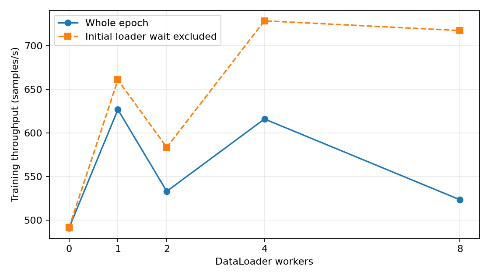
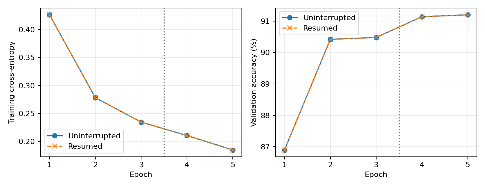

# Lab 06: Training pipelines and project proposal

## Reproduction

```powershell
python main.py
```

The single configuration object is loaded from [config.yaml](config.yaml).
Each experiment runs in a fresh Python process. This prevents a previous batch
size's CPU allocator cache from determining the next run's peak-memory result.
Regenerate the tables, figures, and report without training with
`python main.py --report-only`. Open the recorded experiments with
`mlflow ui --backend-store-uri lab06/results/tracking` in the activated environment.

## Model, data, and controls

The size-matched CNN from Lab 3 had the highest validation accuracy, 92.04%,
among the six recorded models. Its architecture is unchanged: Conv(1,48,3), ReLU,
max-pool, Conv(48,128,3), ReLU, max-pool, and Linear(128 x 7 x 7,10), with
118,634 parameters. All studies start from the same fresh seeded weights;
the Lab 3 test scores are not used to select a model.

Fashion-MNIST uses the original 55,000/5,000/10,000 train/validation/test split,
`ToTensor()` and normalization with mean 0.2860 and standard deviation 0.3530.
Split hashes match Lab 3. Every epoch processes all 55,000 training samples,
including the final partial batch. Validation is evaluated each epoch; the
test set is evaluated once at the final epoch of each run. ReduceLROnPlateau uses
validation loss; the other schedules use the epoch number. Schedulers do not
receive test labels or test scores.

The measurements use cpu, float32, 4 intra-op
threads, one inter-op thread, seed 42, and deterministic algorithms.
The default is Adam, learning rate 0.001, no weight
decay, batch 128, and 1
loader worker for the batch, schedule, optimizer, accumulation, and recovery
comparisons, selected from the worker study. The profile uses zero workers.
Each epoch has a reproducible permutation generated from `seed + epoch_index`.
Package versions and split hashes are recorded in every run's `environment.json`.

Throughput is total training samples divided by training-loop wall time. It
includes loading, forward, backward, optimizer updates, and metric bookkeeping;
it excludes validation, test evaluation, checkpoint writing, and MLflow logging.
Each configuration is measured once. Timing differences include normal machine
load and are observations from this CPU, rather than hardware-independent claims.
CPU peak memory is sampled every 20 ms as
the sum of the main process and worker RSS during training. Shared pages can be
counted more than once across workers, and peaks between samples can be missed.
The CPU batch-size study uses one worker throughout. GPU allocated memory is zero because
CUDA is unavailable on this installation.

## One-epoch profiling

`torch.profiler` records one complete training epoch, with non-overlapping user
ranges around loading, forward/loss, backward, and optimizer update/gradient reset.
The percentages below normalize the four inclusive range durations to 100%.
They do not sum nested operator times. Loading includes iterator creation,
waiting for batches, transforms, and input transfer. Bookkeeping and profiler
overhead outside these ranges are excluded from the phase denominator.

| Phase | CPU range time (s) | Share |
| --- | --- | --- |
| data_loading | 38.83 | 33.14% |
| forward | 39.17 | 33.43% |
| backward | 36.90 | 31.50% |
| optimizer_step | 2.26 | 1.93% |

The profiled training loop took 766.43 s. The four ranges
total 117.16 s; the remaining
649.27 s includes profiler event
collection/aggregation and host bookkeeping outside those ranges.

The largest measured phase is **forward**. The operator breakdown is
saved in [profiler_operators.txt](results/runs/profile/profiler_operators.txt),
with the complete operator totals in
[profiler_operators.csv](results/runs/profile/profiler_operators.csv).
All batches are profiled in windows of 8
steps, and their event totals are added. This bounds profiler memory while
covering the complete epoch, including the final partial window.
Profiling adds overhead, so the study tables use unprofiled training runs.

## Data-loader workers

One full epoch is trained at each worker count, with all other settings fixed.
The initial wait includes Windows worker spawning and the first batch fetch.
The additional throughput column divides the same sample count by training
time with this initial loading wait removed. It helps separate startup cost
from the remaining epoch, but is not a separate warm-epoch experiment.

| Workers | Samples/s | Without initial wait | Initial wait (s) | Loading share | Peak RSS (MiB) |
| --- | --- | --- | --- | --- | --- |
| 0 | 490.91 | 491.18 | 0.06 | 27.25% | 482.00 |
| 1 | 626.84 | 660.97 | 4.53 | 5.75% | 783.45 |
| 2 | 533.04 | 583.49 | 8.92 | 9.30% | 1066.48 |
| 4 | 616.05 | 728.76 | 13.81 | 16.35% | 1612.32 |
| 8 | 523.33 | 717.56 | 28.45 | 27.86% | 2627.73 |



The highest whole-epoch throughput was 626.84
samples/s with num_workers=1. Compare loading wait
with compute time: extra workers can overlap preprocessing, but Windows process
startup, inter-process transfer, RAM pressure, and CPU contention also consume
resources. Fashion-MNIST is already held in memory after ingestion, so this
study measures transformations and batching rather than repeated disk reads.
The range breakdown and measured loading percentages identify whether fetching
or model computation dominates; increasing workers alone cannot remove the
convolution/backpropagation cost.

Model computation is the main limit in the zero-worker run: loading after the initial wait accounts for 27.21% of its remaining epoch. More loader processes cannot eliminate the forward and backward computation. Excluding only the initial loading wait, the fastest worker
count was 4; the full measurements are
saved in [worker_study.csv](results/worker_study.csv).

## Batch-size study

Each batch size is trained for five epochs using Adam and a fixed learning rate.
All configurations start from the same weights and see the same epoch order.

| Batch | Epochs | Samples/s | Peak RSS (MiB) | Final test accuracy |
| --- | --- | --- | --- | --- |
| 32 | 5 | 503.61 | 842.97 | 91.57% |
| 64 | 5 | 516.47 | 844.78 | 91.60% |
| 128 | 5 | 596.31 | 846.99 | 90.87% |
| 256 | 5 | 739.17 | 861.09 | 90.75% |
| 512 | 5 | 800.29 | 1009.25 | 89.91% |

Batch 512 had the highest measured throughput.
Larger batches require larger activations and convolution workspaces, while
performing fewer optimizer updates per epoch. The table therefore reports final
accuracy as well as speed and measured RAM use; equal epochs do not imply equal
numbers of parameter updates.

## Schedules and optimizers

The scheduler comparison fixes Adam and gives each schedule ten epochs.
StepLR multiplies the learning rate by 0.5
every 3 epochs. CosineAnnealingLR uses
T_max=10 and eta_min=1e-05.
ReduceLROnPlateau monitors validation loss with factor
0.5, patience
1, and relative threshold
0.001. The learning rate actually
used for each epoch is stored in its history and MLflow metrics.

| Adam schedule | Epochs | Samples/s | Validation accuracy | Test accuracy |
| --- | --- | --- | --- | --- |
| StepLR | 10 | 409.94 | 92.40% | 92.48% |
| CosineAnnealingLR | 10 | 434.61 | 92.62% | 92.50% |
| ReduceLROnPlateau | 10 | 485.94 | 92.66% | 92.42% |

ReduceLROnPlateau had the highest final validation accuracy in this
single-seed schedule comparison. The plateau scheduler reduced its learning
rate when validation loss stopped improving according to the configured condition.

The optimizer comparison fixes CosineAnnealingLR and a ten-epoch budget for
both methods. Adam uses lr=0.001; SGD uses
lr=0.01 and momentum=0.9.
These optimizer-specific learning rates are fixed in advance. The comparison
is between these two configured training recipes, so differences cannot be
attributed to the optimizer independently of learning rate. The Adam/Cosine run
is shared between the two comparisons.

| Optimizer | Schedule | Epochs | Samples/s | Test accuracy |
| --- | --- | --- | --- | --- |
| Adam | CosineAnnealingLR | 10 | 434.61 | 92.50% |
| SGD | CosineAnnealingLR | 10 | 675.37 | 91.56% |

## Gradient accumulation

Batch 64 with four accumulated microbatches is compared with true batch 256,
using the same sample order, initialization, optimizer, and five-epoch budget.
Cross-entropy is summed per microbatch and divided by the actual number of
samples in its update group. The final group has 216 samples; dividing every
microbatch mean by four would give the final 24-sample microbatch too much weight.
Each epoch performs 215 optimizer updates in both runs. Gradients are reset only
at the start of an update group, and the optimizer steps after the group ends.
The CNN has no batch normalization or dropout that would change microbatch semantics.

| Epoch | Batch 256 loss | 64 x 4 loss | Batch 256 validation | 64 x 4 validation | Updates |
| --- | --- | --- | --- | --- | --- |
| 1 | 0.482920 | 0.482809 | 87.24% | 87.36% | 215 |
| 2 | 0.303672 | 0.303605 | 88.82% | 88.94% | 215 |
| 3 | 0.256638 | 0.256909 | 90.36% | 90.38% | 215 |
| 4 | 0.232219 | 0.232372 | 90.72% | 90.72% | 215 |
| 5 | 0.205662 | 0.206333 | 91.18% | 91.10% | 215 |

The maximum validation-accuracy gap over the five epochs is
0.1200 percentage points;
the maximum training-loss difference is 0.000671.
The configured check requires gaps no larger than 3 percentage points and 0.10
loss. Minor differences can arise from floating-point reduction order. Accumulation
emulates the update batch size while retaining microbatch activation memory;
it requires four forward/backward passes per update and can cost throughput.

## Checkpoint recovery

Training stops after epoch 3 and the process exits. A second process restores
the checkpoint and completes epochs 4 and 5 in the same MLflow run. The saved
state contains model weights, optimizer state, scheduler state when present,
epoch/history, configuration, Python/NumPy/PyTorch/CUDA RNG state, and the loader
generator state. The epoch-based sampler reproduces subsequent data orders.
Checkpoints are written through a temporary file and atomically replaced.



Compared with the uninterrupted batch-128 run, all loss and accuracy values are
identical, and the final maximum absolute parameter difference is
0.0. The epoch-3 checkpoint is retained
as `results/runs/recovery/epoch03.pt`. This verifies epoch-boundary recovery;
resuming partway through a minibatch is outside this experiment.

## Tracking and project proposal

The 17 completed study runs log the resolved configuration, dataset split,
per-epoch losses, accuracy, learning rate, throughput, memory, and final test
metrics. Each run also logs its configuration, environment, history, and summary
as artifacts. Study tables and plots are attached to the relevant runs.
The actual MLflow file store is in `results/tracking/`, and
[mlflow_runs.csv](results/mlflow_runs.csv) lists the run IDs.
[verification.json](results/verification.json) records the completed checks.

The one-page individual proposal is [proposal.pdf](../project/proposal.pdf), with
editable text in [proposal.md](../project/proposal.md), transcribed from the supplied
Task 8 PDF. Its planned 54,000/6,000 project split is separate from the unchanged
55,000/5,000 split used in the Lab 6 experiments. Student ID is
not provided. Instructor approval is pending.

Reading: Reddi, Chapter 8 and §8.7, Chapter 5 §5.5, and Chapter 13 §13.3.
API references: [PyTorch profiler](https://docs.pytorch.org/docs/2.3/profiler.html),
[DataLoader](https://docs.pytorch.org/docs/2.3/data.html), and
[MLflow tracking](https://mlflow.org/docs/2.14.1/tracking.html).
